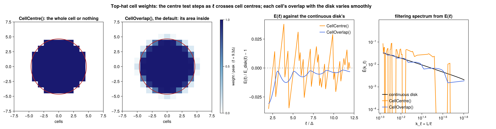
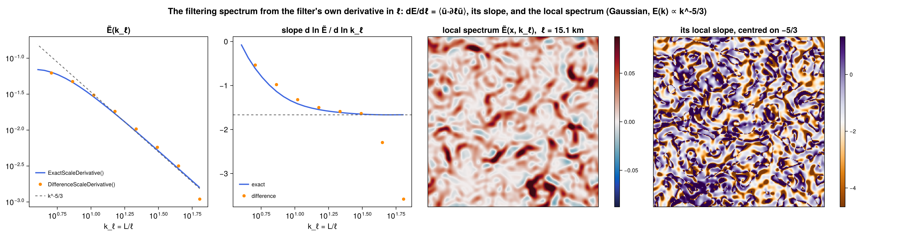
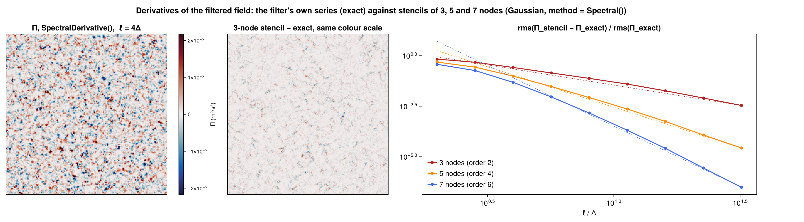
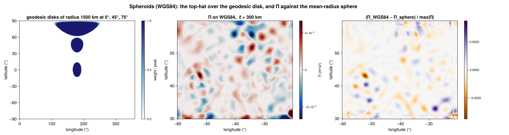
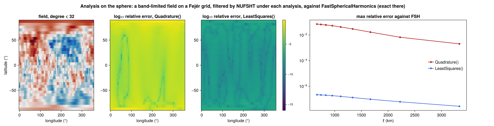
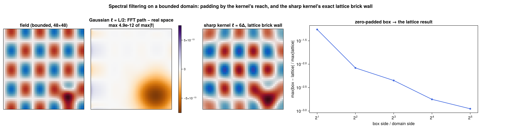

# CoarseGrainingEnergyFluxes.jl

[](https://github.com/jbphyswx/CoarseGrainingEnergyFluxes.jl/actions/workflows/CI.yml)
[](https://jbphyswx.github.io/CoarseGrainingEnergyFluxes.jl/dev/)
[](https://codecov.io/gh/jbphyswx/CoarseGrainingEnergyFluxes.jl)

Spatial coarse-graining (Aluie/FlowSieve-style) analysis of energy fluxes in geophysical fluid
dynamics: cross-scale kinetic-energy transfer Π(x, ℓ), the filtering spectrum, and related
diagnostics from velocity fields on Cartesian or spherical grids — structured, curvilinear
(model-native), and scattered/unstructured, in 1D, 2D, and true 3D.


## What This Package Does

Coarse-graining (spatial filtering) decomposes a turbulent flow into scale-dependent contributions
and measures the energy transferred between them. Given the filtered velocity ū_ℓ and the sub-scale
stress τ_ℓ = (u⊗u)̄_ℓ − ū_ℓ⊗ū_ℓ, the cross-scale kinetic-energy flux is

```
Π(x, ℓ) = −τ_ℓ : S̄_ℓ
```

per unit mass, in m² s⁻³; `ρ₀ Π` is the flux per unit volume (Π > 0 forward cascade, Π < 0 inverse
cascade). Alongside Π the package computes:

| Diagnostic | Function |
|---|---|
| Filtering spectrum and cumulative coarse energy (Sadek & Aluie 2018) | `filtering_spectrum`, `cumulative_energy` |
| Strain/convergence split of Π (Srinivasan, Barkan & McWilliams 2023) | `compute_Π_strain_convergence` |
| Rotational/divergent (Helmholtz) three-way split, including the interaction "stimulated cascade" channel | `compute_Π_decomposed` |
| Leonard/Cross/Reynolds stress decomposition (Cartesian and spherical) | `tau_decomposition` |
| Tracer / buoyancy-variance flux | `tracer_variance_flux` |
| Enstrophy flux, in the same deformation gauge as Π | `enstrophy_flux` |
| Energy per scale band, via the repeated-filter Germano identity | `band_energies` |
| Variable-density (Favre) budget: Π, baropycnal work Λ, and pressure dilatation | `compressible_flux` |

— on masked, regional, or global domains, with real-space (direct-sum) or spectral (FFTW, nonuniform
FFT through NonuniformFFTs or FINUFFT, spherical-harmonic, NUFSHT) backends and
serial/threaded/GPU/distributed/MPI execution.

Each diagnostic has an in-place form taking a workspace, so a sweep over scales or timesteps allocates
nothing after the first call. A workspace holds only the buffers its configuration reaches: a 2-D flux
carries no vertical-component buffers, and the energy/spectrum path takes a two-buffer
`EnergyWorkspace`.

The grid×dimensionality matrix spans 1D transects, 2D (Cartesian or spherical, single-level or the
standard literature "vertical structure" profile method), true 3D (Cartesian and spherical-volumetric,
coupled vertical derivatives), model-native curvilinear grids (orthogonal curvilinear meshes,
via weighted-least-squares gradients), scattered/unstructured point clouds (via k-d tree neighbor
search, Voronoi cell areas, and non-uniform spectral transforms), and the sphere pixelizations.

Every diagnostic takes any grid in that matrix, on either metric. What varies is the rank each one is
defined for:

| diagnostic | rank |
|---|---|
| `compute_Π!`, `coarse_grain`, `cumulative_energy`, `filtering_spectrum`, `band_energies` | 1D, 2D, true 3D |
| `tau_decomposition`, `tracer_variance_flux`, `compressible_flux`, `compute_Π_decomposed` | 2D tangent, and true 3D |
| `vorticity`, `enstrophy_flux`, `compute_Π_strain_convergence` | 2D tangent — the definition of each, the vertical vorticity and the horizontal strain split |

"Any grid" means any layout resolving two tangent directions: `StructuredGrid`, `CurvilinearGrid`,
`UnstructuredGrid` and every sphere pixelization. The gradient each one needs is taken through the
architecture's own operator — a stencil table where there are axes to difference along, a
least-squares tangent-plane fit where there are not — so nothing in these calls names a grid type.

On a sphere every vector and tensor is filtered by the generalized convolution of Aluie (2019), which
commutes with the surface derivatives (see [Vectors on the Sphere](#vectors-on-the-sphere)); and every
spatial operator carries the local frame's `tanφ/R` curvature terms. The suite gates that by asserting
each decomposition's total against `compute_Π!`, which is an identity on either metric.

## Results

### Spatial filtering across scales
Filtering coarsens a field as ℓ grows — shown for a deterministic fractal pattern and an eddy+noise flow.


### Filter kernels and their spectral transfer
Top-hat vs Gaussian (α = 6 Pope / α = 4 FlowSieve) real-space shapes, and the sharp-spectral vs Gaussian transfer functions.


### The filtering spectrum (recovers the Fourier slope)
Cumulative coarse KE E(ℓ) and the spectral density Ẽ(k_ℓ); the sharp-spectral kernel recovers the k⁻³ slope, while a Gaussian smooths it.


### Rotational / divergent (Helmholtz) decomposition of Π
Π splits exactly into rotational→rotational, divergent→divergent, and interaction ("stimulated cascade") channels.


### Strain / convergence split of Π


### Enstrophy flux (the 2-D companion to Π)


### Energy by scale band


### Variable-density (Favre) budget: Π, baropycnal work Λ


### Cross-scale tracer / buoyancy-variance flux
The scalar analogue of Π (buoyancy ⇒ available-potential-energy transfer).


### Masking: zero-fill vs deformable
`ZeroFill` is the default: land and the domain exterior count as fluid at rest (Aluie et al. 2018; Grooms et al. 2021), and the kernel keeps its full mass at every cell, so filtering commutes with spatial derivatives — the step the flux budget is derived by. Every output is defined on every cell: `Π` over land is nonzero within the kernel's reach of the coast and zero beyond it, and domain means sum every cell over the water area. `Deformable` renormalizes over the locally-active area, reproducing constants exactly next to a boundary at the cost of that commutation, and zeroes masked cells. The two differ within the kernel's reach of a coast or bounded edge.


### Spectral filtering on the sphere
Global spherical-harmonic filtering (FFTW, the nonuniform FFT, FastSphericalHarmonics and NUFSHT cover Cartesian/spherical × uniform/scattered).


### Validation: rigid-body rotation → Π = 0
Pure rotation has no deformation, so the flux must vanish (to machine precision).


### Curvilinear (model-native) grids
A sheared/rotated curvilinear mesh filtered via weighted-least-squares gradients — no rectilinear
assumption anywhere in the pipeline.


### Scattered / unstructured point clouds
k-d tree neighbor search, exact Voronoi cell areas and nonuniform-FFT spectral filtering give a
`compute_Π!` flux map on scattered observations.


### True 3D volumetric flux (Cartesian and spherical shells)
Coupled 3D strain and stress (all nine components), filtered by one kernel that spans all three
directions, as for homogeneous/isotropic turbulence.


### Vertical profile (2.5D per-level) vertical structure
The literature-standard "vertical structure" method (Aluie, Hecht & Vallis 2018): the 2D/2.5D
`compute_Π!` run independently at each vertical level and stacked into a profile.


### Top-hat cell weights
The default `CellOverlap()` weighs each cell by its area inside the disk, so `E(ℓ)` and the filtering spectrum
vary smoothly with `ℓ`; the centre test, `CellCentre()`, steps as `ℓ` crosses the cell centres.



### The filtering spectrum's derivative in ℓ, slope and local spectrum
`dE/dℓ = ⟨ū·∂ℓū⟩` through the filter itself, the spectrum's slope per scale, and the local spectrum and slope per
cell.



### Derivatives of the filtered field
The strain from the filter's own series against stencils of 3, 5 and 7 nodes.



### Spheroids
The top-hat over the geodesic disk on WGS84, and Π there against the mean-radius sphere.



### Analysis on the sphere
Quadrature against the least-squares fit for a band-limited field on a Fejér grid.



### Spectral filtering on a bounded domain
Padding by the kernel's reach, and the sharp kernel's exact lattice brick wall.



## Quick Start

```julia
using CoarseGrainingEnergyFluxes: CoarseGrainingEnergyFluxes as CGEF
using FlowGeometries: FlowGeometries as FG   # geometries and grid types live here
using NUFSHT: NUFSHT                         # fast spin-weighted transforms for vectors on a sphere

# Create grid
geom = FG.Geometry.SphericalGeometry(6.371e6)  # Earth radius in meters
grid = FG.Grids.StructuredGrid(geom, lon_rad, lat_rad, mask)

# Run multi-scale analysis
scales = collect(10e3:10e3:300e3)  # 10 km to 300 km
result = CGEF.coarse_grain(u, v, grid; scales = scales, kernel = CGEF.TopHatKernel(),
                           spectrum = CGEF.Diagnostics.NoSpectrum())

# result.Π                 — (Nlon, Nlat, Nscales) stacked flux array; result.Π[:, :, i] at scales[i]
# result.cumulative_energy — ½⟨|ū_ℓ|²⟩ per scale, per unit mass (Sadek–Aluie Eq. 15)
# result.wavenumber        — k_ℓ = L/ℓ

# The top-hat's |Ĝ|² is not monotone, so it cannot carry a filtering spectral density (Sadek & Aluie
# 2018 eq. 21) and `coarse_grain` refuses to produce one. Ask a kernel that can:
spec = CGEF.coarse_grain(u, v, grid; scales = scales, kernel = CGEF.GaussianKernel())
# spec.filtering_spectrum  — Ẽ(k_ℓ) spectral density (Eq. 14)
```

Not sure what a given `(grid, kernel, ℓ)` will actually do? `CGEF.check_setup(grid, kernel, ℓ)` reports
the engine, the resolved execution backend, whether the kernel can carry `Π` and a spectrum, whether `ℓ` is
resolvable on that grid, and how far from a coast or domain edge the result depends on the mask
strategy — without building a plan.

Only a minimal set of names is exported at the top level: the sweep entry points (`coarse_grain`,
`coarse_grain!`, `coarse_grain_profile`, `coarse_grain_profile!`, `coarse_grain_batch!`,
`coarse_grain_slices!`), their result
types, `check_setup`, the three headline kernels, and `plot_Π_map`/`plot_spectrum`. Grids and
geometries come from FlowGeometries.jl, and everything else — `filter_field!`, `compute_Π!`,
`compute_Π_strain_convergence`, `compute_Π_decomposed`, `tau_decomposition`, `tracer_variance_flux`,
`enstrophy_flux`, `band_energies`, the remaining kernels, backends, mask strategies,
`derivative_plan`, `plan_filter`, `plan_filter_sweep`, `spectral_transfer`, the workspaces
(`ΠWorkspace`, `EnergyWorkspace`, `TauWorkspace`, `Sym3TauWorkspace`, `FavreWorkspace`,
`EnstrophyFluxWorkspace`, …), … — is reached through the
qualified submodule path shown in [Architecture](#architecture) below, e.g.
`CGEF.Diagnostics.compute_Π!(...)`, `CGEF.Filtering.filter_field!(...)`.

## Architecture

Geometries, grid types and the execution/spectral backend taxonomies are external packages
(`FlowGeometries.jl`, `ComputationalBackends.jl`, `SpectralBackends.jl`); this package is the
coarse-graining engine on top of them.

```
src/
  Geometry.jl     — a cell's area or volume inside a top-hat's support: box and polygon against a disk,
                    lat–lon cell against a cap or a geodesic disk, box and shell cell against a ball
  Kernels.jl      — TopHatKernel, GaussianKernel, SmoothHatKernel, HyperGaussianKernel,
                    HighOrderKernel{P}, SharpSpectralKernel, their derivatives in ℓ
  Filtering.jl    — filter_field! (real-space footprint engine + spectral plan dispatch)
  Filtering/      — the module's files: Strategies, Lifetimes, CacheStrategy, Hooks, Api, Apply,
                    Plans, Selection, Slices, Shares (process backends), Rates (ℓ-derivatives),
                    VectorFilter, SpinDirect, SpinRings, SpinFit (the generalized convolution), and
                    engines/ (Exterior, Overlap, HighOrder, Footprint, Banded, PrefixSumTopHat,
                    PrefixSumTopHat3D, Separable, NDim, ScatteredND, BinnedTopHat, Nodes, NodeSpectral,
                    FFTSpectral, NUFFTSpectral — the nonuniform FFT through FlowTransformBindings)
  Derivatives.jl  — the derivative tags, derivative_plan: FlowGeometries' stencil plans on a
                    StructuredGrid, its least-squares gradient plan elsewhere; ddz! for a stack of
                    levels. The strain, curl and frame rotations are FlowGeometries.Operators'
  Diagnostics.jl  — compute_Π!, compute_Π_decomposed, compute_Π_strain_convergence,
                    tau_decomposition, tracer_variance_flux, enstrophy_flux, band_energies,
                    compressible_flux, cumulative_energy, filtering_spectrum
  Diagnostics/    — the module's files: SpectrumPolicy, Flux, TensorDriver, SpinFilter, Spectrum,
                    Stress, Helmholtz, StrainConvergence, Tracer, Favre, Bands, Enstrophy
  Pipeline.jl     — coarse_grain / coarse_grain! / coarse_grain_profile / coarse_grain_batch! /
                    coarse_grain_slices!, check_setup (high-level orchestration)
  Visualization.jl — plot_Π_map / plot_spectrum stubs (methods provided by the CairoMakie ext)
ext/
  AbstractFFTsExt               — FFT spectral filtering (uniform Cartesian StructuredGrid; bounded axes zero-padded
                                  by the kernel's reach) and the padded and zonal FFT engines, through any provider
  FFTWExt                       — declares FFTW the host FFT provider and passes it the thread count
  AbstractFFTsDistributedExt    — FFT spectral filtering across Distributed worker processes (SharedArrays)
  KernelAbstractionsAbstractFFTsExt — declares the FFT provider of device arrays
  FastSphericalHarmonicsExt     — spherical-harmonic transform (StructuredGrid on Fejer1Sampling, nlon = 2·nlat − 1),
                                  scalar and spin-weighted
  NUFSHTExt                     — non-uniform spherical-harmonic transform (scattered spherical UnstructuredGrid), and
                                  the spin-weighted transforms over any spherical grid's cells
  OhMyThreadsExt                — ThreadedBackend (2D row-parallel; also 1D/true-3D point-parallel)
  KernelAbstractionsExt         — GPUBackend via KernelAbstractions
  DistributedExt                — DistributedBackend (Distributed + SharedArrays)
  MPIExt                        — MPIBackend (multi-node domain decomposition)
  SpecialFunctionsExt           — exact top-hat spectral transfer 2·J₁(kR)/(kR)
  CairoMakieExt                 — plot_Π_map / plot_spectrum implementations
```

Backend implementations and the transform libraries are **package extensions** (weak dependencies),
so the core package has no heavy dependencies. The nonuniform FFT runs through FlowTransformBindings,
whose own extensions bind NonuniformFFTs and FINUFFT: `using NonuniformFFTs` or `using FINUFFT` enables
it, and `transform = FlowTransformBindings.FINUFFTBackend()` (or `NonuniformFFTsBackend()`)
names one.

## Grid Types

| Grid | Dimensionality | Real-space filter | Spectral filter | Derivatives | `compute_Π!` |
|------|-----------------|--------------------|-----------------|--------------|--------------|
| `StructuredGrid` | 1D, 2D, true 3D (Cartesian, spherical or spheroidal; a 3-D sphere or spheroid is a volumetric shell) | Yes | Yes (an FFT on uniform Cartesian axes; FastSphericalHarmonics on `structured_grid(Fejer1Sampling(), N)`; any other over its cells by the nonuniform transform) | `Derivatives.derivative_plan`: `FG.Operators.stencil_plans` per direction | Yes, all dimensionalities + a 2.5D vertical-profile wrapper (`coarse_grain_profile`) |
| `CurvilinearGrid` | 2D (model-native, orthogonal curvilinear meshes) | Yes (per-point footprint, no translation invariance assumed) | Yes, over its cells by the nonuniform FFT | `FG.Operators.gradient_plan` + `FG.Operators.gradient!` (least-squares tangent plane) | Yes |
| `UnstructuredGrid` | 1D (scattered points) | Yes, and the default (`RealSpace()` — ball query over the grid's own adjacency) | Yes (nonuniform FFT for 1–3 Cartesian coordinates; NUFSHT spherical) | the same, over the grid's k-d tree adjacency | Yes |
| `RingGrid`, `CubedSphereGrid`, `HEALPixGrid`, `IcosahedralGrid`, `YinYangGrid` | 1D (sphere pixelizations: one index names a cell) | Yes, and the default — the same node CSR gather over each grid's own ball query | Yes, over its cells by NUFSHT | `Derivatives.derivative_plan`: `FG.Operators.gradient_plan`, through each grid's own adjacency | Yes |

`CurvilinearGrid` carries exact quadrilateral corner-based cell areas; `UnstructuredGrid` carries a
k-d tree adjacency and Voronoi-tessellation cell areas (`NearestNeighbors`/`DelaunayTriangulation`/
`Quickhull`). Both run the same `compute_Π!`/`coarse_grain` pipeline as `StructuredGrid`, sharing the
per-point tensor-rotation kernel.

```julia
using NearestNeighbors: NearestNeighbors     # enables UnstructuredGrid's k-d tree neighbor search
using DelaunayTriangulation: DelaunayTriangulation  # enables exact Voronoi areas (Cartesian)
# using Quickhull: Quickhull                 # enables exact Voronoi areas (spherical)

ug = FlowGeometries.Grids.UnstructuredGrid(geom, x, y, mask; k = 8)  # k-nearest neighbors, auto Voronoi areas
```

## Filter Kernels

| Kernel | Description | Use case |
|--------|-------------|----------|
| `TopHatKernel(; cells = CellOverlap())` | Uniform weight within radius ℓ/2, each cell weighed by its area inside the disk, cap or geodesic disk (`CellCentre()`: by its centre) | Standard, most common (spectral transfer needs `using SpecialFunctions`) |
| `GaussianKernel(; α = 6)` | Gaussian, variance-matched to a box of width ℓ (`σ² = ℓ²/12`) | Smooth, differentiable, has an exact spectral transfer |
| `SharpSpectralKernel()` | Ideal low-pass, `Ĝ = 1` for `k ≤ π/ℓ`; in real space its inverse transform in the grid's dimension (sinc, jinc, spherical Bessel), truncated near `10ℓ` | Scale separation with `method = Spectral()`; in real space the 2-D form needs `using SpecialFunctions` |
| `SmoothHatKernel(; steepness = 10)` | Tanh-tapered top-hat (Storer et al.) | A box without the discontinuity; real space only on the plane |
| `HyperGaussianKernel(; α = 1)` | Super-Gaussian, `exp(-α(2d/ℓ)⁴)` | Flatter core, steeper skirt than a Gaussian; real space only on the plane |
| `HighOrderKernel(; order = 3, b_over_ℓ = 1/8)` | `order` vanishing moments, `order ∈ (3, 5)` (Sadek & Aluie `M^I`/`M^II`): the product `G(x)G(y)` on the plane, its isotropic form on a sphere | Lifts the filtering spectrum's `k⁻³` slope ceiling. Signed, so not for Π |

On the plane `SmoothHatKernel` and `HyperGaussianKernel` have no closed-form transfer function; every
other kernel can be used with `method = Spectral()`. On a sphere every kernel scales a degree-`l`
harmonic by the Legendre transform of its real-space weight, `Kernels.spectral_transfer_degrees!`
(`SharpSpectralKernel`'s needs `using SpecialFunctions`), which the spectral filter and the vector
filter both use. `filtering_spectrum` requires a monotone `|Ĝ|²`, and only
`GaussianKernel` and `SharpSpectralKernel` have one — see `Kernels.transfer_monotone`, or ask
`check_setup`.

On a grid the filter is a sum over cells, so `HighOrderKernel`'s order is set by the moments of its
weights. Its weights are the kernel's mean over each cell, corrected by the least change that makes every
moment of degree `1…P` vanish on the cells each point sees: once per axis on a rectilinear grid, once
per latitude row on a sphere of uniform longitude, and once per point elsewhere.

`RealSpace()` names the operator — a local space average against the compact kernel — and the engine
that evaluates it, with its cost, is picked from the grid and kernel. `check_setup` reports which one
a given configuration takes.

| Kernel | Grid | Real-space algorithm | Cost |
|--------|------|----------------------|------|
| `TopHatKernel` | a rectilinear 2D `StructuredGrid` (Cartesian, spherical or spheroidal) with a uniform axis 1, or any axes under `CellCentre` but a spheroid's | per-row prefix sums + monotone two-pointer interval sweep, each row's rim cells added with their overlap weights | `O(N · w_y)` plus the rim cells, exact |
| `TopHatKernel` | uniform Cartesian 3D `StructuredGrid` | per-plane prefix sums; the ball's `x`-interval is contiguous at each `(dy, dz)` | `O(N · w_y · w_z)` plus the rim cells, exact |
| `GaussianKernel`, `HighOrderKernel` | Cartesian `StructuredGrid`, 1D/2D/3D, uniform or stretched axes | one separable pass per axis | `O(N · Σᵈwᵈ)`, exact up to the square-vs-disk truncation shape |
| any radial | 2D grid with a uniform axis 1, any axis 2 (one band on a uniform Cartesian grid, one per row otherwise, a Mercator latitude included) | banded footprint, contiguous axpy along `x` | `O(N · wx · wy)` |
| `HighOrderKernel` | sphere of uniform longitude, any latitude axis | banded footprint, one correction per latitude row | `O(N · wx · wy)` |
| any | everything else (curvilinear meshes, a nonuniform axis 1) | bounded per-point window (optionally cached, see `AbstractCacheStrategy`); a `HighOrderKernel` corrected per point | `O(N · window)` |

The per-point engine stores each point's neighbour list when it fits the cache budget, a quarter of the
memory available to the process by default and shared by every scale of a `plan_filter_sweep`;
otherwise it recomputes the list on every apply. A node set's neighbour list past that budget raises before
it is allocated. `plan_filter(…; engine)` names an engine (`Filtering.AbstractEngine`), and the smooth
kernels' footprints end where the weight falls to `Kernels.truncation_tol(T)` of its peak, `1e-10` or
`8 eps(T)` where the element type resolves less.

Two further engines evaluate that **same** convolution by transform. On a CPU backend `RealSpace()`
takes one where it applies and costs fewer operations than the kernel's own engine above (a fused
multiply-add per tap of a direct sum or separable pass, a few per band of the prefix sums, against
`2.5 n log₂ n` per real transform of length `n`), so a kernel a few cells wide keeps its engine:

| Engine | Applies to | Cost |
|--------|-----------|------|
| padded FFT of the sampled kernel | uniform Cartesian, 1D/2D/3D, any kernel | `O(N log N)` |
| zonal FFT along longitude | sphere of uniform longitude (a ring, or a regional box zero-padded along longitude), radial kernel or `HighOrderKernel` with one correction per latitude row — for a fixed pair of latitudes the weight depends on the longitude offset alone, so each band is a convolution along longitude | `O(N·(log Nλ + w_φ))` |

Each samples the weights the engine it replaces sums — a separable kernel's per-axis tables, a radial
kernel's ball or the banded engine's rows — and agrees with it to round-off; a device, Distributed or
MPI plan takes the direct engines. Neither samples a transfer function or truncates in spherical
harmonics, so the kernel keeps its compact support.

### Sweeping scales

A plan splits into three parts by how often each changes: what the **grid** fixes (transform objects,
measure prefix scans, point sorts), what the **scale** fixes (tap tables, `Ĝ(ℓ)`, the reciprocal window
mass), and transient **scratch**. `plan_filter` builds one of each for a single scale;
`plan_filter_sweep` builds the grid part and the scratch **once** for a whole sweep:

```julia
# one grid plan, one scratch, N scale plans
family = CGEF.Filtering.plan_filter_sweep(grid, kernel, scales)

result = CGEF.coarse_grain(u, v, grid; scales = scales)   # allocates the result and a workspace
ws = CGEF.Diagnostics.ΠWorkspace(grid)
for t in 2:nt                                            # later timesteps reuse all three
    CGEF.coarse_grain!(result, us[t], vs[t], grid; scales = scales,
                       filter_plans = family, workspace = ws)
end
```

A `FilterPlanFamily` is an `AbstractVector` of the per-scale plans, accepted anywhere a vector of
plans is. `coarse_grain` builds one internally for a one-shot sweep; `coarse_grain!` takes a prebuilt
one, along with the result and workspace to write through. One family may not be applied from several
tasks at once — the scratch is shared — so give each concurrent worker its own.

### Derivatives and the filtering spectrum

The strain differentiates the filtered velocity through the filter's own series where it filters spectrally
(`method = Spectral()`, and the generalized convolution on a sphere), and by 5-node differences or the
least-squares gradient elsewhere; `derivative = Derivatives.PhysicalDerivative(; nodes)` or
`Derivatives.SpectralDerivative()` names one. The filtering spectrum takes `dE/dℓ = ⟨ū·∂_ℓū⟩` through the
filter where the kernel has a derivative in `ℓ` (`scale_derivative`), and a sweep returns the spectrum's slope
per scale under `slopes = Diagnostics.Slopes()` and the local spectrum per cell under
`spectrum_maps = Diagnostics.SpectrumMaps()`.

## Execution Backends

The execution backend, the `execution` keyword of every entry point, changes only *how* a call runs.
Every map it returns is identical to the serial path's; on a `GPUBackend` a domain sum such as
`cumulative_energy` is reduced in the device's order and agrees with the serial one to round-off. Every
backend below applies the footprint/plan that `plan_filter` builds once per `(grid, kernel, scale)`.

On a `GPUBackend` the fields passed in are device arrays, and a diagnostic's workspace, the grid copies
its loops read, and the maps it returns live in the device's memory: `ΠWorkspace(grid; execution)`
builds a workspace there, and a workspace built for the host refuses a device plan.

| Backend | Extension | Grid shapes supported | Notes |
|---------|-----------|------------------------|-------|
| `SerialBackend()` | — | Everything | The reference every other backend is asserted bit-identical to |
| `ThreadedBackend()` | OhMyThreads | 2D structured/curvilinear (row-parallel); 1D and true-3D structured, and every flat-cell grid (cell-parallel) | |
| `GPUBackend()` | KernelAbstractions | the same three shapes | Device residency established once with the plan; kernels run the grid's own ball query, so device and host maps are bit-identical |
| `DistributedBackend()` | Distributed + SharedArrays | the same three shapes | Multi-process on one shared-memory node; each worker holds its block and workspace from plan build and writes a `SharedArray` |
| `MPIBackend()` | MPI | the same three shapes | Multi-node, a contiguous block per rank + in-place `Allreduce!`; exercised by `test/mpi_runtests.jl` under `mpiexec` |
| `AutoBackend()` | — | — | Picks `ThreadedBackend` where OhMyThreads is loaded and `nthreads() > 1`, else `SerialBackend` |

`DistributedBackend`/`MPIBackend` are parametric over an inner local backend (e.g.
`MPIBackend(ThreadedBackend())`) for hybrid execution.

## Vectors on the Sphere

A local (east, north) pair filtered component by component is not a filtered vector, and the
ambient Cartesian components filtered one by one are not either: the components of the gradient of a
degree-`n` harmonic carry degrees `n ± 1` (Aluie 2019). Every diagnostic filters a vector and a tensor on
the surface of a sphere by Aluie's generalized convolution, which multiplies each degree-`n` vector and
tensor harmonic by the kernel's `Ĝ(n)`: filtering then commutes with the surface gradient, divergence
and curl, and a vector is filtered as the scalars of its Helmholtz decomposition. It runs as
spin-weighted spherical-harmonic transforms, the velocity at spin 1 and the stress at spins 0 and 2:

```julia
using NUFSHT                       # any spherical grid; FastSphericalHarmonics + FFTW serve its own grids
res = coarse_grain(u, v, grid; scales, kernel = GaussianKernel())
```

With neither library loaded the transforms are an in-core direct sum, `O(M·lmax²)` over `M` cells.
`vector_filter = Filtering.CartesianComponents()` filters the ambient Cartesian components and rotates
them back, the method `Deformable` and a spheroid take; `vector_filter =
Filtering.GeneralizedConvolution(; lmax, analysis)` sets the transforms' degree and how they take a field's
coefficients, by quadrature or a least-squares fit (by default the fit where the grid's quadrature is not
exact at its band limit), and `transform` chooses their library. The theory page derives the spin-weighted
form.

`compute_Π_decomposed` takes the rotational part of the velocity, from
[HelmholtzDecomposition.jl](https://github.com/jbphyswx/HelmholtzDecomposition.jl), and filters it and
the divergent remainder by the same filter, which keeps each part rotational or divergent.

## References

- **Aluie (2019)**: doi:10.1007/s13137-019-0123-9 — Convolutions on the sphere
- **Aluie, Hecht, Vallis (2018)**: doi:10.1175/JPO-D-17-0100.1 — Mapping the energy cascade
- **Aluie (2011)**: doi:10.1016/j.physd.2011.06.001 — Compressible turbulence coarse-graining
- **Germano (1992)**: doi:10.1017/S0022112092001733 — The filtering approach (Leonard/Cross/Reynolds)
- **Sadek & Aluie (2018)**: doi:10.1103/PhysRevFluids.3.124610 — Extracting the spectrum by spatial filtering
- **Storer et al. (2022)**: doi:10.1038/s41467-022-33031-3 — Global energy spectrum
- **Buzzicotti et al. (2023)**: doi:10.1126/sciadv.adi7420 — Global cascade of kinetic energy
- **Barkan, Srinivasan & McWilliams (2024)**: doi:10.1175/JPO-D-23-0191.1 — Eddy–internal wave interactions: stimulated cascades (the interaction channel in `compute_Π_decomposed`)

## See Also

- [HelmholtzDecomposition.jl](https://github.com/jbphyswx/HelmholtzDecomposition.jl) — Helmholtz decomposition, the rotational part `compute_Π_decomposed` takes
- [StructureFunctions.jl](https://github.com/jbphyswx/StructureFunctions.jl) — Structure function analysis (complementary to filtering)
- [FlowSieve](https://flowsieve.readthedocs.io/) — C++ coarse-graining toolkit (Storer et al.)
